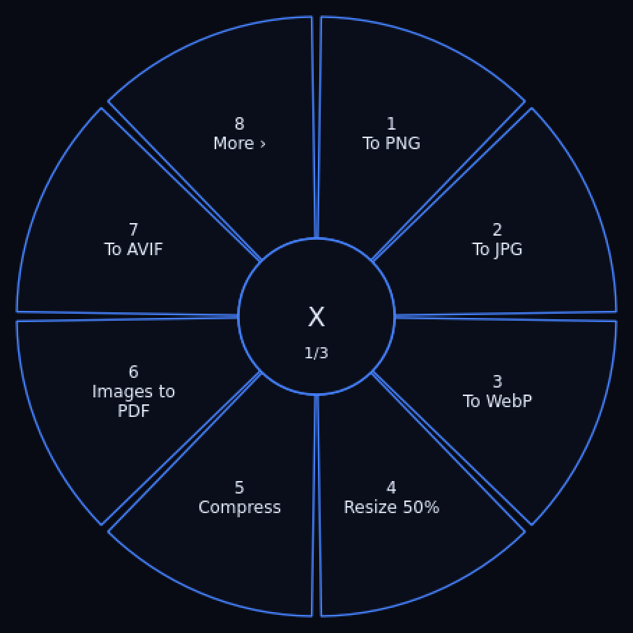

<p align="center">
  
</p>

<p align="center">
  
  
  
  
</p>

<p align="center"><b>Grayson</b> is a zero-click, fully offline file converter for Windows.
Copy a file, tap <kbd>Ctrl</kbd>+<kbd>Shift</kbd>+<kbd>Space</kbd>, and a ring menu opens at
your cursor with everything you can do to that file. Pick a slice. Done.</p>

---

<p align="center"></p>

## What it does

The ring shows only what fits the file you selected. More than 8 actions? The
8th slice is **More ›** and pages through the rest (labels never collide).

| You give it | The ring offers |
|---|---|
| **Images** (png, jpg, webp, bmp, tiff, gif, heic, avif, ico) | To PNG / JPG / WebP / AVIF / HEIC / BMP / TIFF / GIF / ICO, resize 50%, compress, grayscale, rotate 90, crop (square, 16:9, custom %), images to PDF, images to Word |
| **Video** (mp4, mkv, mov, webm, avi, m4v, wmv, flv, mpg, 3gp) | To MP4 / WebM / GIF / MKV / MOV / AVI, compress, scale to 720p, remove audio, extract MP3 or WAV, trim, merge |
| **Audio** (mp3, wav, ogg, m4a, flac, aac, opus, wma, aiff) | To MP3 / WAV / OGG / FLAC / M4A / AAC / Opus, compress, trim, merge |
| **PDF** | Merge, split, compress, pages to PNG or JPG, extract text, to Word (text only) |
| **Word** (docx, doc, odt, rtf) | To PDF / DOCX / ODT / RTF / text / HTML, pages to PNG |
| **PowerPoint** (pptx, ppt, odp) | To PDF / PPTX / ODP, slides to PNG |
| **Excel / CSV** (xlsx, xls, ods, csv) | To PDF / XLSX / ODS / CSV / HTML |
| **Text** (txt, md, html) | To PDF, HTML, plain text (built in), to Word |

Every conversion runs **locally** - no upload, no account, no watermark, no
conversion allowance. Output lands next to the original as `name-grayson.ext`
and never overwrites anything. `grayson --list` prints every action.

### Office documents need LibreOffice (or Microsoft Office)

Word / PowerPoint / Excel conversions use **LibreOffice** in headless mode. It
is *not* bundled (it would add about 350 MB), so install it once, free:

```powershell
winget install TheDocumentFoundation.LibreOffice
```

Grayson finds it automatically (`GRAYSON_SOFFICE`, the standard install
folders, or PATH). If LibreOffice is missing but Microsoft Office is installed,
"to PDF" falls back to Word / PowerPoint / Excel through COM. Images, video,
audio, PDF and text/Markdown/HTML conversions need nothing extra.

## Install

**Easiest (installer):** download `Grayson-Setup.exe` from the latest
[Releases page](../../releases/latest) and run it. It installs Grayson for
your user (no admin needed), adds a Start menu entry, offers a desktop
shortcut and an optional "start Grayson when Windows starts" entry, and can
be uninstalled later from Settings > Apps. If LibreOffice is missing, the
installer closes with a reminder that Word/PowerPoint/Excel conversions need
it (image, video, audio, PDF and text conversions work without it).

The installer is **not code-signed**, so Windows SmartScreen will warn
("Windows protected your PC"). Click **More info -> Run anyway** if you
trust this repo.

**Portable zip:** download `Grayson-windows.zip` instead, unzip anywhere,
run `Grayson.exe`. Same app - no installer, no Start menu entry, nothing to
uninstall.

**From source** (Python 3.10+):

```powershell
git clone https://github.com/mjanthony819/grayson.git
cd grayson
pip install .
grayson --gui
```

For audio/video actions from source you also need ffmpeg
(`winget install ffmpeg`), unless `imageio-ffmpeg` is installed - then it just works.

## Use it

1. **Ring menu** - copy file(s) in Explorer with `Ctrl+C`, press
   `Ctrl+Shift+Space`. The ring opens at your cursor. Click a slice or press
   its number. `Esc` or the centre `X` cancels.
2. **Drop zone** - drag files onto the small Grayson window instead.
3. **Command line** - the same engine, scriptable:

```powershell
grayson --list                                   # every action
grayson photo.png --action img-to-webp
grayson a.pdf b.pdf c.pdf --action pdf-merge
grayson clip.mp4 --action vid-trim --param start=5 --param end=12
```

## How it works

```
Explorer copy / drag-and-drop
        |
   kind detection  (grayson/core.py - extension -> image | video | audio | pdf | word | slides | sheet | text)
        |
   action registry (one declarative table -> which actions fit the selection)
        |
   ring menu (PySide6, QPainter donut slices, paged past 8 actions)
        |
   conversion engine - Pillow (images) | PyMuPDF (PDF, text) | ffmpeg (audio/video) | LibreOffice (Office)
        |
   unique output name next to the source -> tray notification
```

The conversion engine is a plain Python library (`grayson/convert/`) with no Qt
imports, so the CLI and the GUI share identical behaviour and the whole engine
is testable without a display.

## Development

```powershell
pip install -e ".[dev]"
python -m pytest tests/ -q
```

54 tests cover kind detection, the action registry, ring slice geometry and
paging, every image/PDF/text conversion, ffmpeg round-trips (generated clips),
real LibreOffice round-trips (docx/pptx/xlsx) and the CLI.
GUI painting is smoke-tested offscreen with Qt's `offscreen` platform.

CI (`.github/workflows/build.yml`) runs the tests on Ubuntu, then builds the
portable `Grayson-windows.zip` with PyInstaller on `windows-latest`, compiles
`Grayson-Setup.exe` from it with Inno Setup (`installer/grayson.iss`) and
attaches both to releases.

## Honest limitations

- **Windows-focused.** The engine is cross-platform, but the hotkey +
  Explorer clipboard flow is built and packaged for Windows.
- Trim **re-encodes** instead of stream-copying, so the cut lands exactly
  where you asked (stream copy snaps to keyframes) - slower on long files.
- PDF compress downsamples large embedded images to ~1500px JPEG; it is not a
  lossless archiver.
- Office conversions need LibreOffice (or Office) installed; first run of
  LibreOffice is slow (several seconds per file). Complex layouts can shift.
- **PDF to Word is text only** - no layout, tables or images, and scanned PDFs
  have no text layer (there is no OCR).
- HEIC and AVIF output depend on `pillow-heif` / Pillow's AVIF support.
- **Not yet tested on a real Windows machine**: the .exe, the installer
  (Start menu entry, startup registry key, uninstaller), the hotkey, the
  Explorer clipboard flow and the Word/PowerPoint COM fallback. The engine and
  the ring (rendered offscreen) are tested on Linux and in CI; the installer
  is compiled in CI but nobody has run it on real hardware yet.
- The installer is **unsigned**, so SmartScreen warns. Code-signing
  certificates cost money; there is none.
- ffmpeg is LGPL/GPL; the Windows bundle pulls it in via `imageio-ffmpeg`.

## Stack

Python - PySide6 (ring menu, tray) - pynput (global hotkey) - Pillow (images) -
PyMuPDF (PDF) - python-docx / Markdown - LibreOffice (Office, external) - ffmpeg via imageio-ffmpeg (audio/video) - PyInstaller (packaging) -
pytest + GitHub Actions (CI).

---

<p align="center"><i>Built by a dual degree student who got tired of upload-wait-download converters.</i></p>
